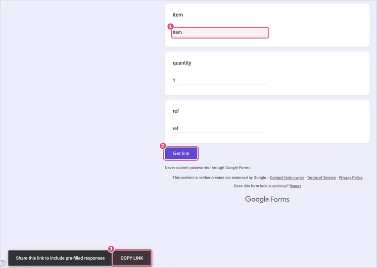
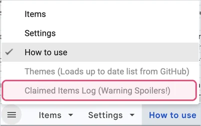

# Gift claiming

[← Back to the README](../README.md)

Gift claiming adds a button to every item so gift-givers can mark what they bought. Everyone else sees how many are left, and an item greys out and moves to the end once it's taken, so nobody buys the same thing twice. You won't see what was bought unless you go looking.

The button's wording depends on your theme: "I bought this", "Loot", "Claim it", "I got this!".

## Turn it on

### The quick way: one click

In your sheet, click **Wishlist → Set up gift claiming**.

It makes a claim form called "Wishlist claims" in your Google Drive, adds its three questions, connects it to your sheet, hides the tabs that show purchases, fills in your **Settings** tab and switches claiming on. When it says **Gift claiming is set up ✓**, you're done. The buttons appear on your site within about 5 minutes.

First time using the menu? Google asks for your permission once: [here's what to expect](sheet-menu.md#using-it-the-first-time), and [why it's nothing to worry about](about-the-warnings.md). No Wishlist menu in your sheet? [Here's how to add it](sheet-menu.md#no-wishlist-menu-in-your-sheet), or follow the steps below.

### By hand

If you'd rather not use the menu, it takes a few minutes.

**1. Create your claim form.** In your sheet, go to **Tools → Create a new form**.


Google makes a new form that's already connected to your sheet, opens it in a new browser tab, and adds a responses tab to your sheet called **Form Responses 1**. (If the sheet has had a form before, it may be **Form Responses 2** or **3** instead. That's fine: step 5 covers it.)

**2. Add three questions.** Give the form any title you like, like "Wishlist claims". Then make three **Short answer** questions named exactly **item**, **quantity** and **ref**, in that order:


- The form starts with one "Untitled Question". Rename it to **item** and change its type to **Short answer**.
- Click **⊕** (Add question) on the right for the other two.
- Leave them all optional (don't switch on **Required**).

**3. Copy its pre-filled link.** In the form, click **⋮** (top right) → **Pre-fill form**.


A copy of the form opens. Type anything into the three boxes (the words don't matter), click **Get link**, then **COPY LINK** in the bar at the bottom left.



> [!NOTE]
> It has to be this pre-filled link. The form's regular share link doesn't include the question details the site needs, and the setup check (`?check`) will tell you if the wrong one got pasted.

**4. Paste it and switch it on.** Back in your sheet, on the **Settings** tab, paste the link into **Claim form link** and tick **Enable item claiming**.

**5. Check the responses tab's name, then hide it.** Look at the new **Form Responses** tab at the bottom of your sheet.

- **Called Form Responses 1?** Nothing to do.
- **A different number, like Form Responses 3?** Click that tab, copy the whole address from your browser's address bar, and on the **Settings** tab add a row: `Claims tab link` in column A, the address in column B. That tells your site where to look.

Then right-click the responses tab and choose **Hide sheet**, since it shows what people bought. If Google put it first, drag it to the end before hiding it: **Items** must stay the first tab.

The buttons appear on your site within about 5 minutes. Open your site with `?check` on the end to confirm everything's connected.

> [!WARNING]
> Don't change or reorder the form's three questions (item, quantity, ref). The site depends on them. Renaming the form is fine.

## Keep the surprise

Purchases are recorded in your **Form Responses** tab, and the hidden **Claimed items (Warning Spoilers!)** tab keeps a copy for your site. Keep both hidden. Hidden tabs show up greyed out in the sheet's list of tabs (the ☰ button at the bottom left), so you can see they're there without opening them.



On each of your own phones and computers, open your site once with `?shield` added to the end of the address:

```
https://your-username.github.io/wishlist/?shield
```

That browser will hide everything that's been bought from then on. Use `?shield=off` to undo it.

> [!TIP]
> Want to try the button without recording anything? Add `?test-claims` to the address instead. Nothing gets sent, so you can click around freely.

## Fixing mistakes

A gift-giver can press **Undo** right after marking something. For anything else, someone needs to delete that row in the hidden **Form Responses** tab. Ask a partner or friend to do it so you don't see the spoiler.

## Turning it off

Untick **Enable item claiming** on the Settings tab. Your form and its responses stay where they are, so you can tick it again later.

## Sheets from before the template

If your sheet has no **Settings** tab (it was made before the template existed, before October 15, 2026), claiming is set up in `config.js` instead. Make a Google Form with three short-answer questions, in this order: **item**, **quantity** and **ref**.

- Don't add number-only rules to quantity, because Undo sends a negative number.
- Don't require sign-in.

Then link it to a sheet (**Responses → Link to Sheets**), publish that sheet (**File → Share → Publish to web → Comma-separated values**), and fill in the `claims` section of `config.js`:

| Setting | Where it comes from |
|---|---|
| `csvUrl` | The responses sheet's published link |
| `formUrl` | The form's pre-filled link, with `viewform?…` changed to `formResponse` |
| `itemField`, `qtyField`, `refField` | The `entry.123456` numbers in the pre-filled link, in question order |
