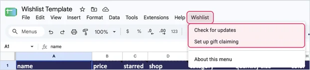
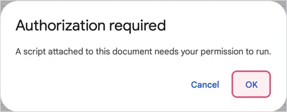
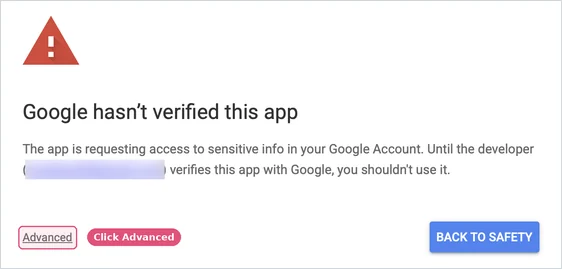
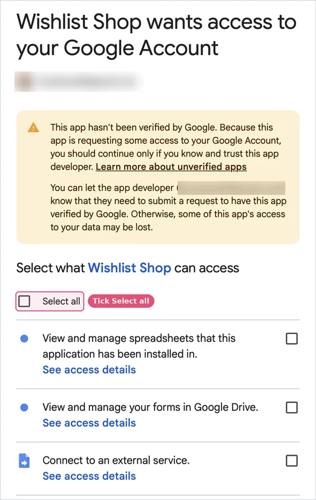
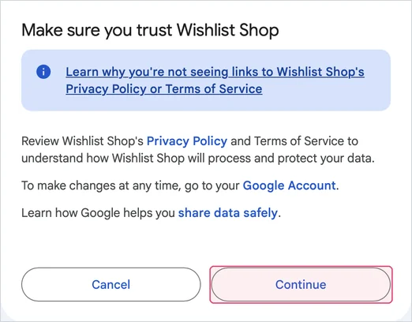
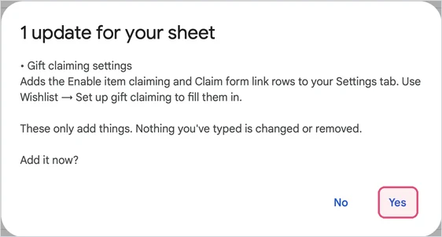

# The Wishlist menu

[← Back to the README](../README.md)

Your sheet can have a **Wishlist** menu, next to **Help** at the top. It does two things for you:

- **Check for updates.** When Wishlist Shop adds something new to the sheet, like a new setting, this adds it to your copy. It shows you exactly what it will add and waits for you to say yes. It only ever adds things: nothing you've typed is changed or removed.
- **Set up gift claiming.** Makes your claim form, adds its three questions, connects it to your sheet, hides the tabs that show purchases and fills in your Settings tab. It replaces all the [by-hand steps](claiming.md#by-hand).

After the first time you use the menu, opening your sheet also shows a small note in the corner whenever an update is waiting.

The menu is optional. Everything it does can also be done by hand, and your site works the same either way.

## Using it the first time

The first time you click anything in the Wishlist menu, Google asks for your permission. Because this is a small homemade script rather than an app from Google's store, Google shows a warning screen. It's expected, and you only see it once.

**1. Google says Authorization required.** Click **OK**, then pick your Google account.

**2. Google says Google hasn't verified this app.** Click **Advanced** (small, at the bottom left), then **Go to Wishlist Shop (unsafe)**, which appears underneath.

> [!TIP]
> Look at the email address on this screen: it's **your own**. When Google says to continue only if you trust the developer, it means you. The copy of the script in your sheet belongs to you, so Google lists you as its developer.

**3. Google asks what Wishlist Shop can access.** Tick **Select all**. (If you leave a box unticked, parts of the menu won't work.)

**4. Scroll down and click Continue.**

The menu item runs straight away. (If nothing happens, click it again.) Google won't ask again.

> [!NOTE]
> "Unsafe" is Google's word for any script it hasn't reviewed, which is almost every personal script. You're giving permission to the copy of the script inside **your own sheet**, which only you can edit. Nobody else, including whoever made Wishlist Shop, gets access to your sheet or your account.
>
> **Want to be sure?** [About Google's warnings](about-the-warnings.md) explains why this screen appears and gives you simple ways to check the script for yourself.

## What it can and can't do

Here's what each permission on that screen is for, in plain words:

| Google says | What the menu uses it for |
|---|---|
| View and manage spreadsheets that this application has been installed in | Adding rows and tabs to **this** sheet only. It can't see your other spreadsheets. |
| Display and run third-party web content in prompts and sidebars inside Google applications | Showing its messages, like "1 update for your sheet". |
| View and manage your forms in Google Drive | Making your claim form. It doesn't open or change your other forms. |
| Connect to an external service | Downloading the public [list of updates](../sheet/updates.json). It's set so it can only reach this project's website, and it never sends anything from your sheet. |
| Allow this application to run when you are not present | Showing the "update available" note when you open your sheet. |

**What it can't do:**

- Run new code from the internet. The list of updates is plain data. It can only ask for the few actions written into the script, like "add a row named Footer text".
- Touch your items. **Check for updates** never changes or removes anything you've typed. **Set up gift claiming** only fills in the claiming rows on your Settings tab, and asks first if you already have a claim form link.
- Share your sheet or send its contents anywhere.

You can read the whole script, with comments, in [`sheet/Wishlist.gs`](../sheet/Wishlist.gs). To remove its permission at any time, go to [your Google account's third-party connections](https://myaccount.google.com/connections) and remove **Wishlist Shop**.

## No Wishlist menu in your sheet?

Copies made before the menu was added don't have it. You can add it in about two minutes:

1. In your sheet, open **Extensions → Apps Script**. A code editor opens in a new tab.
2. Delete everything in the editor, then paste in the whole of [`Wishlist.gs`](../sheet/Wishlist.gs) (on that page, use the **Copy raw file** button at the top right of the code).
3. Click the **gear icon** (Project Settings) on the left and tick **Show "appsscript.json" manifest file in editor**.
4. Back in the editor (the **< >** icon), click **appsscript.json**, delete everything, and paste in the whole of [`appsscript.json`](../sheet/appsscript.json).
5. Click the **save icon**, then close the tab and reload your sheet. The **Wishlist** menu appears after a few seconds.

## If the menu doesn't show up

- It appears a few seconds after the sheet finishes opening. Reload the page if it hasn't.
- Google's Sheets app on phones and tablets doesn't show added menus. Open your sheet in a web browser instead.
- Still missing? Your copy may be older than the menu: see the steps just above.

## Updating the menu itself

The menu rarely needs updating, since new sheet changes arrive through **Check for updates**. If Wishlist Shop ever adds a new kind of action, **Check for updates** will say a newer version of the menu is available. To update it, repeat steps 1 and 2 of [No Wishlist menu in your sheet?](#no-wishlist-menu-in-your-sheet) (and step 4 if [`appsscript.json`](../sheet/appsscript.json) changed).
